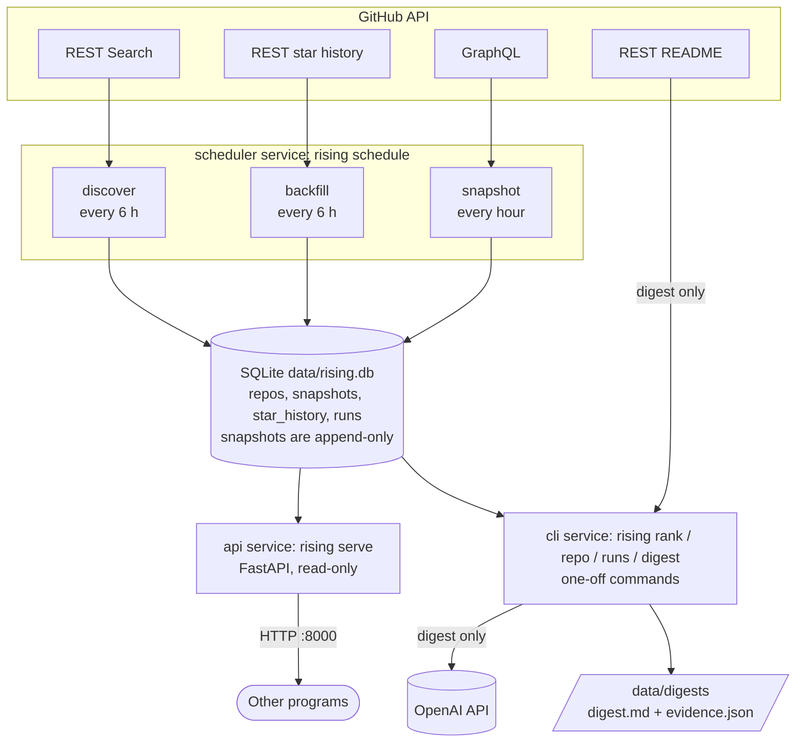

# Architecture

Container view ([C4](https://c4model.com/) level 2): what runs, where the data lives and what
flows between them. One Docker image runs as three Compose services that share one SQLite file.

